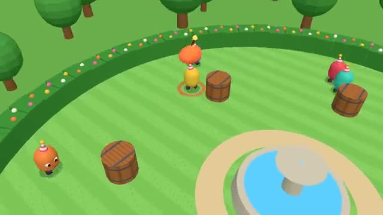

# Hot Potato

Pass the ticking potato. Don't hold it when it blows. A multiplayer starter game from [Multiplayer Agent](https://multiplayeragent.com): 3D, party, 3–8 players, with bots that fill empty seats.

## How it plays

Whoever holds the hot potato passes it by touching someone, and nobody knows when it will go off. Holding it at the bang knocks you out; the last one left wins.

**Controls:** WASD or arrow keys and Space to dash, or the touch stick and Dash button.

## Make it yours in the Game Builder

Open the [Game Builder](https://multiplayeragent.com), choose **Start from a starter game** and pick Hot Potato. It opens as version 1 in your studio, ready to play and publish. Then ask for changes, for example:

- Make it a snowball fight in a snowy park
- Add a second potato when there are lots of players
- Add speed boots that appear on the grass

## Run it yourself

1. Get a free publishable key (`pk_…`) at [multiplayeragent.com](https://multiplayeragent.com).
2. In `index.html`, put it in place of `pk_REPLACE_ME` in the `MP_CONNECT` block.
3. Serve the folder (for example `npx serve`) and open it. The 3D engine loads as a module, which browsers block from a file on disk.

Without a key it still runs, offline against bots.

## How it is built

- One `index.html` plus three.js in `libs/`. The comment at the top of the script maps the code and explains the multiplayer.
- **Host-run rounds:** The host's browser deals the potato, sets its fuse and decides every pass; if it leaves, the next player takes over.
- **Bots:** Bots fill the garden until enough people join, and chase or run like players.
- **Live sync:** Everyone sees the same potato in the same hands at the same moment.
- **Leaderboard:** The players who won the most games, on the results card.
- Fuse times, the no-pass-back rule, speeds and the blast are in the `CONFIG` block; the fountain and barrels are the `OBSTACLES` list.
- `?attract` runs it offline with bots only. The preview video is recorded from it.

## License

MIT. three.js in `libs/` is MIT too (Copyright 2010-2024 three.js authors).
